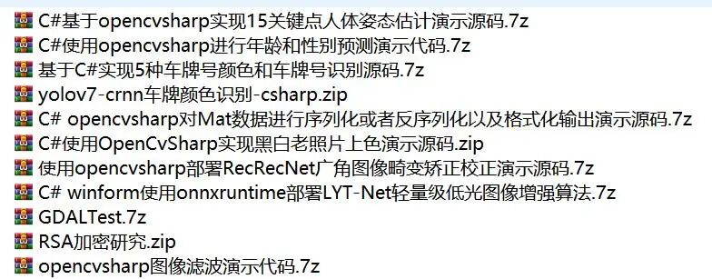
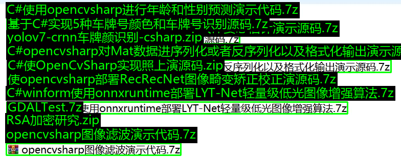

# Deploying the PyTorch model of PP-OCRv5 based on Python, without using Paddle Framework source code + model

Project idea: PaddleOCR, as a leading open-source OCR tool, has attracted much attention due to its excellent performance.

Project idea:

PaddleOCR, as a leading open-source OCR tool, has attracted much attention due to its excellent performance. However, this tool natively supports only the paddlepaddle framework.

In numerous practical projects, the application of Pytorch framework is more widespread. If a separate installation of paddlepaddle framework is made in a project, it will not only cause the project to become bulky and redundant but also may lead to compatibility conflicts between different frameworks.

Therefore, there are currently three commonly used methods:

Method 1: Convert to ONNX model, directly use ONNXRuntime for inference without Paddle environment.

Second method: Call the paddle_inference library, directly encapsulate for inference, commonly used with C++ or C# development.

Third method: Convert to PyTorch model, directly use PyTorch for inference without Paddle environment.

This project is using the third method:

PaddleOCRv5 inference model => PyTorch model

## Used Model

Detection Model: ptocr_v5_mobile_det.pth

Recognition model: ptocr_v5_mobile_rec.pth

Dictionary file: ppocrv5_dict.txt

If you need the server model, you can get it from the PaddleOCR2Pytorch repository.

## Project Structure

```
code/
├── main.py            # Main program entry point
├── utils/ # Tool Functions Directory
└── visualize.py # Visualization-related functions
└── test_img/ # Test image directory

```

## Usage Method

### Installation Environment

conda creat -n py310 python=3.10

conda activate py310

pip install torch==2.2.1+cu118 torchvision==0.17.1+cu118 -f https://download.pytorch.org/whl/torch_stable.html

pip install -r requirements.txt

### Command-line Parameters

-

- `--data_path`

**Required Parameters**, specify the input image path or directory path.

-

- `--save_path`

**Optional Parameters**, specify the path or directory where results are saved.

-

- `--show_confidence`

:**Optional Parameter**, whether to display confidence in the resulting image (default is not displayed)

### Single Image Processing

python main.py --data_path test_img/general_ocr_rec_001.png --save_path output/result.png

### Catalogue Bulk Processing

python main.py --data_path test_img --save_path output

## Inference Video

python main_video.py --video_path test_video/ocr_test.mp4

Effect:

Original image:

 Edit

Identification effect:

 Edit


## Payment

Here is a pay link on Stripe ( https://buy.stripe.com/3cs8yP7sY87d0vu9AB ). Please contact me lonlonago@foxmail.com after funding $89, and I will send you a complete data files , thank you!


